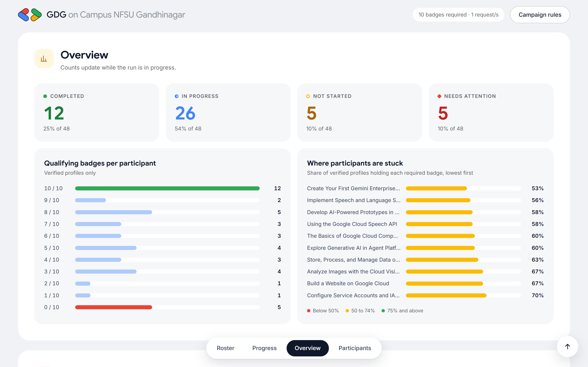

# Verity: Learn With Communities Tracker

**Live:** https://lwc-tracker.onrender.com (access token required)

A secure, rate-limited tracker for the **Learn With Communities** campaign, built for GDG on Campus NFSU Gandhinagar (Tech & Development lead task).

Give it the participant CSV. It reads each Google Skills public profile once, counts the qualifying skill badges, and shows who has completed the campaign, who is close, and which rows need a human look.

- **Web dashboard** (FastAPI): upload or paste a roster, watch live progress, filter and search, open any row for counted and missing badges, export CSV or JSON.
- **CLI** (Rich): `validate` a roster offline, `check` it from the terminal, write results to CSV or JSON.
- **Offline demo mode** with synthetic profiles (it also injects 429 and 503 responses, so you can see retries happen).



## Quick start

Requires Python 3.11+ (developed on 3.14).

```bash
pip install -r requirements.txt
```

```bash
python -m lwc_tracker serve
```

Open http://127.0.0.1:8000, then drop in a CSV.

Offline demo, with a "Load demo roster" button in the UI:

```bash
python -m lwc_tracker serve --demo
```

From the terminal:

```bash
python -m lwc_tracker validate samples/students.csv
```

```bash
python -m lwc_tracker check samples/students.csv -o results.csv --json results.json
```

`check` exits with code 3 if some profiles could not be fetched or read, so it can be used in scripts.

## Roster CSV

Any CSV with a column of public profile links works. Columns are detected by content, not position:

- the **link** column is the one whose cells contain `public_profiles/`
- **name** and **email** columns are matched by header (`Name`, `Student Name`, `Email`, `E-mail Address`, …)
- comma, semicolon or tab separated, UTF-8 (with or without BOM); a header row is optional

Accepted link forms: `https://www.skills.google/public_profiles/<uuid>`, the older `www.cloudskillsboost.google` domain, `http://`, missing scheme, and trailing slashes, query strings or fragments. Anything else is reported as an invalid row before any request is made.

`samples/students.csv` has a real profile plus deliberately broken rows. `samples/demo_roster.csv` matches the demo mode.

## Campaign rules: `campaign.toml`

| Setting | Default | Meaning |
|---|---|---|
| `required_count` | 10 | Qualifying badges needed to complete |
| `required_badges` | the 10 campaign badges | Only these count; leave empty to count every badge |
| `aliases` | one example | Map a renamed badge's old title to its current title |
| `start_date` / `end_date` | empty | Optional window; badges outside it are shown but not counted |
| `requests_per_second`, `burst` | 1.0, 2 | Global outbound pace |
| `concurrency` | 3 | Parallel workers |
| `max_retries`, `backoff_*` | 3, 1.5 s, 30 s cap | Retry policy for transient errors |
| `cache_ttl_seconds` | 900 | Reuse parsed profiles for 15 minutes |
| `circuit_breaker_threshold` | 8 | Consecutive upstream failures before a run stops |
| `max_upload_bytes`, `max_rows` | 1 MB, 5,000 | Upload limits |

Every value is validated and clamped to a safe range at start-up. The badge list in this repo comes from the example profile in the problem statement. Replace it with the official list from Discord if that differs.

### Statuses

| Status | Rule |
|---|---|
| Completed | at least `required_count` qualifying badges |
| In progress | 1 to `required_count - 1` |
| Not started | 0 |
| Needs attention | invalid link, profile not found or private, fetch error, unreadable page |

Flags (shown as tags; they never change the count): **Shared profile** (same profile in more than one row), **Name mismatch** (roster name shares no word with the profile name), **Outside window**.

## Deploy on Render

The repo includes a [Render Blueprint](render.yaml) that runs the real, token-protected tracker on Render's free plan.

1. Open https://render.com/deploy?repo=https://github.com/raykon6/lwc-tracker and sign in.
2. Approve the Blueprint. Render installs `requirements.txt` and starts `python -m lwc_tracker serve --host 0.0.0.0`.
3. In the service's **Environment** tab, copy `VERITY_ACCESS_TOKEN` (Render generates it). The site asks for it once per browser session.

What the Blueprint sets:

| Variable | Purpose |
|---|---|
| `VERITY_ACCESS_TOKEN` | Generated secret. Every API call needs it, so strangers cannot use your server to send requests |
| `VERITY_TRUST_PROXY=1` | Use Render's `X-Forwarded-For`, so inbound rate limits apply per visitor |
| `PYTHON_VERSION` | Python 3.12 |
| `PORT`, `RENDER_EXTERNAL_HOSTNAME` | Provided by Render. Used for the listening port and the Host-header allowlist |

Free Render services sleep after 15 minutes without traffic, and the first visit after that takes about 30 seconds. `/healthz` is the only route that skips the token and Host checks, so Render can probe the container.

### Other servers

`serve` binds to `127.0.0.1` by default. To serve on a network:

```bash
python -m lwc_tracker serve --host 0.0.0.0 --public-name tracker.example.lan
```

When it binds beyond localhost, an access token is required. Set `VERITY_ACCESS_TOKEN`, or the server generates one and prints it in the terminal. Put it behind HTTPS (a reverse proxy) for anything other than a trusted LAN. Set `VERITY_TRUST_PROXY=1` only when a proxy is the sole way to reach the app.

## Tests

```bash
pip install -r requirements-dev.txt
```

```bash
python -m pytest -q tests
```

74 tests cover link validation (SSRF cases), CSV parsing, formula-injection escaping, the parser and campaign rules, retries, 429 handling, the circuit breaker, CSRF, Host and Origin checks, upload limits, token auth, inbound rate limits, and an end-to-end run.

## Project layout

```
campaign.toml            campaign rules and limits
lwc_tracker/
  security.py            URL allowlist and UUID extraction, output encoding
  roster.py              defensive CSV parsing and column detection
  fetcher.py             token bucket, retries, circuit breaker, size caps
  parser.py              badge extraction from profile HTML
  campaign.py            badge matching, aliases, campaign window
  engine.py              orchestration, statuses, flags, cache
  jobs.py                in-memory runs for the web app
  export.py              CSV / JSON export
  demo.py                synthetic profiles for offline demos
  cli.py                 command line interface
  web/app.py             FastAPI app and security middleware
  web/static/            dashboard (vanilla HTML, CSS, JS)
tests/                   pytest suite
docs/                    deck, screenshots, security notes
```

## Presentation

`docs/Verity_LWC_Tracker.pptx` covers the problem, need, logic, tech stack, process and practical impact.

See [docs/SECURITY.md](docs/SECURITY.md) for the threat model.

---

Independent community project. Not managed by Google. Google Skills is a trademark of Google LLC.
